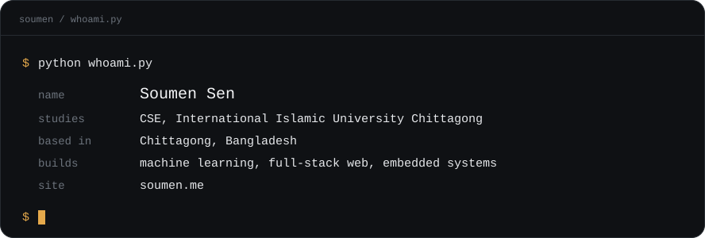
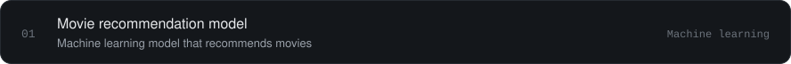
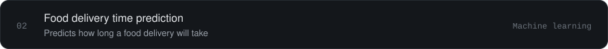
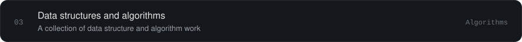
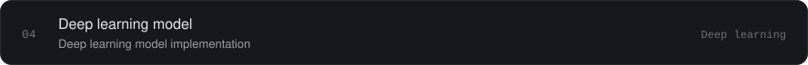
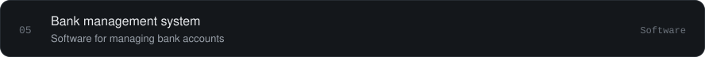
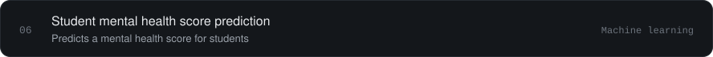
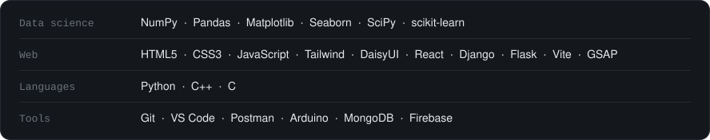

  

### `~/projects`

 
 
 
 
 

[All repositories](https://github.com/soumensen411?tab=repositories)

### `~/stack`

### `~/activity`

### `~/contact`

[Portfolio](https://soumen.me) · [GitHub](https://github.com/soumensen411) · [LinkedIn](https://www.linkedin.com/in/soum-en-sen/) · [Email](mailto:soumensen411@gmail.com) · [LeetCode](https://leetcode.com/u/soumensen411/) · [HackerRank](https://www.hackerrank.com/profile/Soumensen) · [Instagram](https://www.instagram.com/soum_en_sen/)

<!-- Discord: your old link had no user ID. Add [Discord](https://discord.com/users/YOUR_ID) to the line above once you have it. -->
